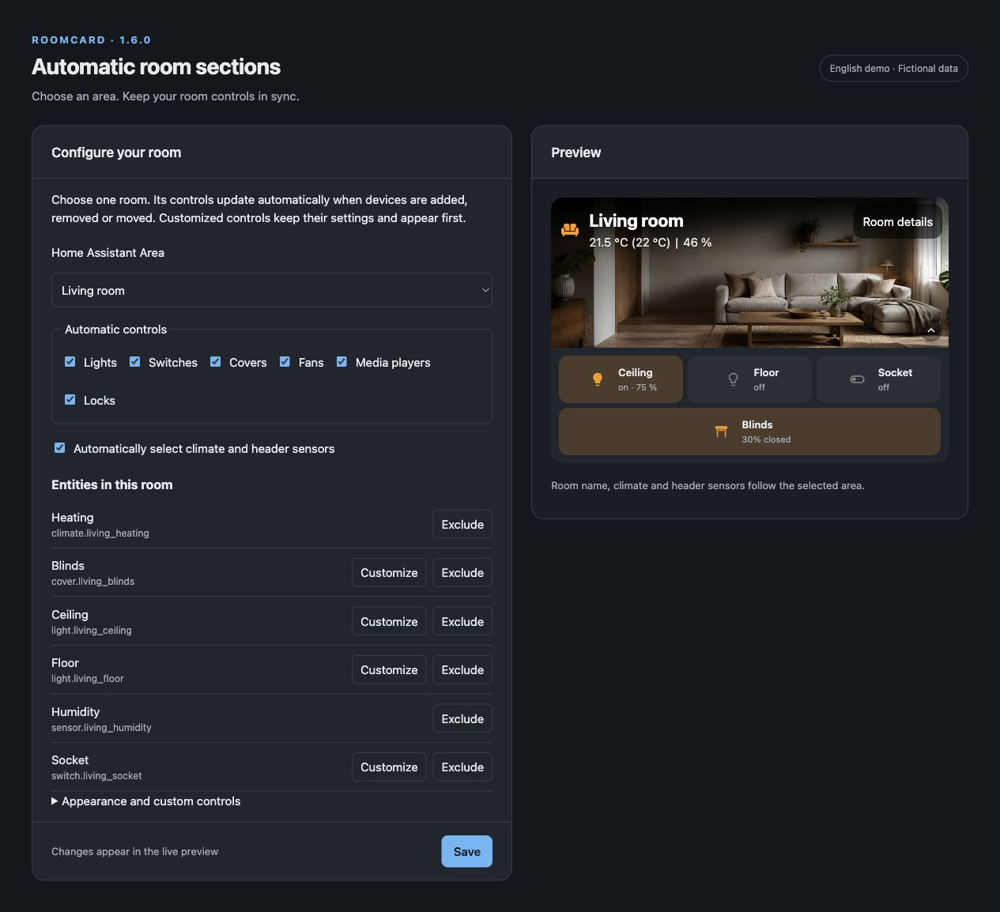
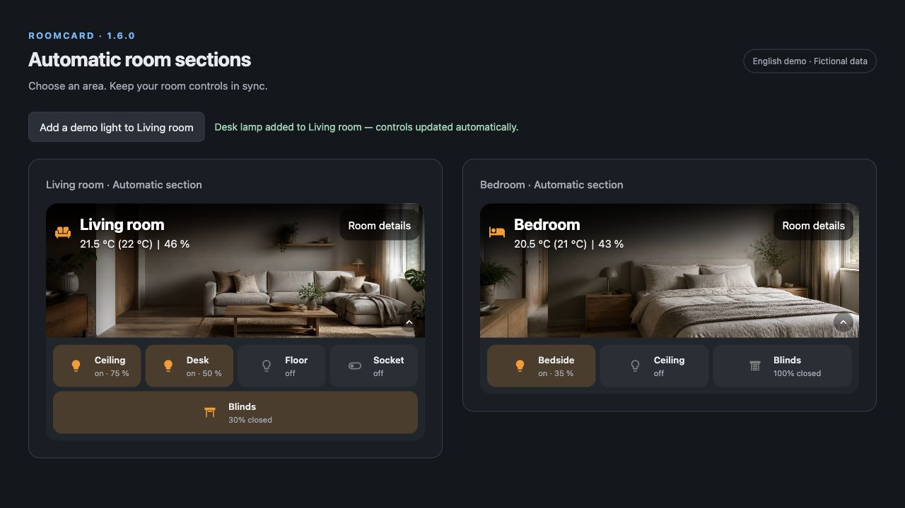

# RoomCard v1.6.0 — Automatic room sections

Choose a Home Assistant area and let RoomCard keep its controls in sync as devices
are added, removed or moved. This release also fixes built-in room-image delivery
for fresh Marketplace/HACS installations.

## A room that follows your devices

On **Home Assistant 2026.11 or newer**, edit a sections dashboard and choose
**Create section → Automatic section → Community sections → RoomCard**.

Select an area, choose which control types to include, and optionally let RoomCard
select climate, temperature, humidity, contact and battery sensors automatically.
The visual editor supports English, German and French.

Use **Customize** to keep your own label, actions, size or room-detail placement
for an individual control. Use **Exclude** to leave an entity out and restore it
later. Explicit controls keep their settings and appear before automatic controls.
Hidden, disabled and diagnostic entities are excluded from automatic discovery.

Automatic membership updates retain the existing RoomCard instance, room-detail
drawer and remembered collapse state. Ordinary entity-state updates continue to
use the card's normal rendering. Closes [#158](https://github.com/lop1505/RoomCard/issues/158).

The screenshots show the real RoomCard bundle and editor in a local demo host.
All rooms, entity IDs and states are fictional; no private dashboard data is used.
The surrounding demo layout is separate from Home Assistant's native dialog.

## Built-in images on fresh installations

All **16 preset JPEGs** now ship directly beside `room-card.js` and are attached
individually to this release. Marketplace/HACS can install them without unpacking
a supplementary ZIP or relying on a previous `rooms/` directory. Fixes
[#161](https://github.com/lop1505/RoomCard/issues/161).

Source modules also have distinct filenames so Marketplace's branch-install
fallback cannot replace the compiled bundle with unbundled source.

## Updating and compatibility

* Update through Marketplace/HACS, then fully reload the dashboard.
* If you installed today's commit-pinned test candidate, install **v1.6.0** through
  the existing Room Card update entry. Keep a single RoomCard module resource.
* For a manual installation, copy **every file from `dist/`** into the same folder:
  `room-card.js` and all 16 `.jpg` files. The attached manual-install ZIP contains
  this same flat layout.
* Automatic sections require HA 2026.11+. Existing standalone cards, manual YAML,
  custom image URLs, uploads and the one-time Area Setup remain supported.

## Validation

**160 automated tests** pass, with syntax checks, deterministic bundle comparison,
release-metadata validation and a clean local installation of the individual
release-asset set. The native Community section picker and editor were checked
on **Home Assistant 2026.11.1** in Safari; the maintainer approved the smoke test.
Broader Marketplace clean-install, migration and release-update checks remain
tracked separately in [#157](https://github.com/lop1505/RoomCard/issues/157).

See the [configuration guide](https://github.com/lop1505/RoomCard/blob/v1.6.0/README.md)
and [full changelog](https://github.com/lop1505/RoomCard/blob/v1.6.0/CHANGELOG.md).
